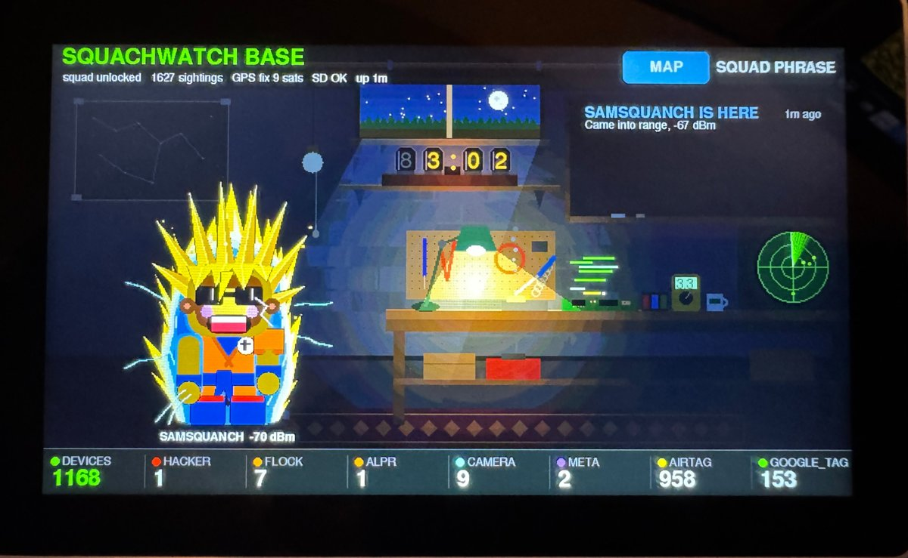
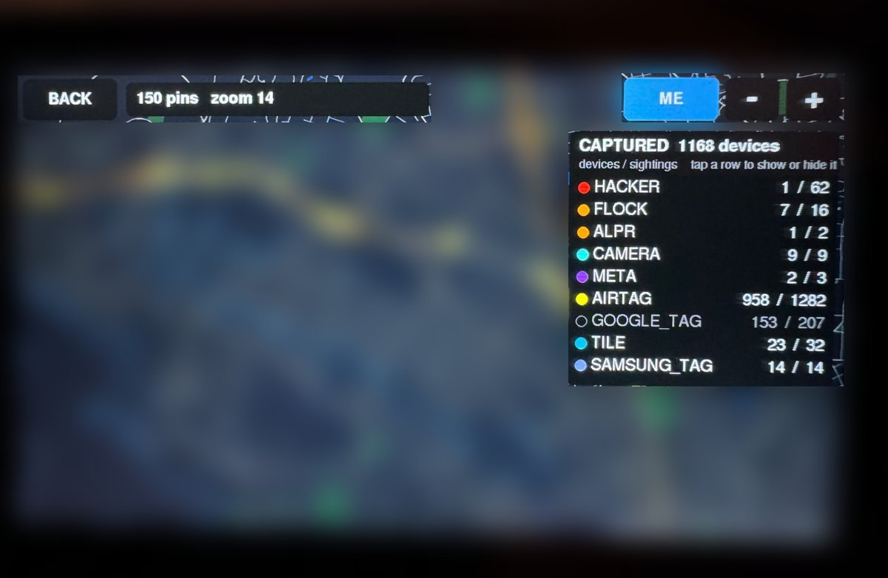

# SquachWatch Home Base

**Small detectors in the field. A base station at home. Your catches sync when you walk in the door.**

This branch of [SquachWatch](https://github.com/skizzophrenic/SquachWatch-CYD) (by TalkingSasquach) holds the **M5Stack Tab5 base station** and **home sync**, frozen at versions that are tested and working. It does not follow upstream, so upstream changes can't break it.

## How it works

1. Carry a SquachWatch board with GPS. It logs every catch it detects (Flock and ALPR cameras, Axon gear, skimmers, trackers, hacking tools and more) with time and position to its SD card.
2. Come home. The board sees your WiFi, finds the Tab5 as `squachbase.local`, and hands over the rows it hasn't sent yet.
3. The catches go straight onto the Tab5's offline map, coloured by how much they matter.

## The base station (M5Stack Tab5)

- **The basement:** every board in range walks in as its own Squachy. A radar, a Nixie clock, a window with the real sky and weather, seasonal decorations.
- **The map:** offline OpenStreetMap tiles from the SD card, every catch as a pin, zoom 12 to 20. Make tiles for your own area on a PC in a few minutes.
- **Set up on the screen:** WiFi, time zone (including British Columbia's UTC-7 all year), touch calibration, brightness, sound.
- **Imports:** drop a board's SD log on the card to put a whole drive on the map.

## Get it

Download `tab5-base.bin` from the [Releases](../../releases) page, copy it to the Tab5's SD card and install it with [Launcher](https://github.com/bmorcelli/Launcher). Setup, the SD card layout and how to make map tiles: [docs/TAB5-BASE.md](docs/TAB5-BASE.md). The original SquachWatch README is in [docs/UPSTREAM-README.md](docs/UPSTREAM-README.md).

For the board side, build a board with home sync on (`-DSQW_HOME_SYNC=1`), for example `pio run -e waveshare-c5-28-gps`.

## Credits

SquachWatch and the Squachy characters are by TalkingSasquach ([upstream](https://github.com/skizzophrenic/SquachWatch-CYD)). The Tab5 base station and home sync are by bobsdinner-cell. GPL-3.0, like upstream.
