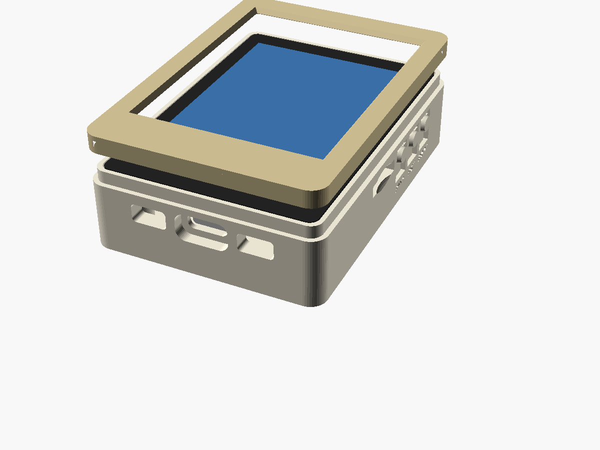
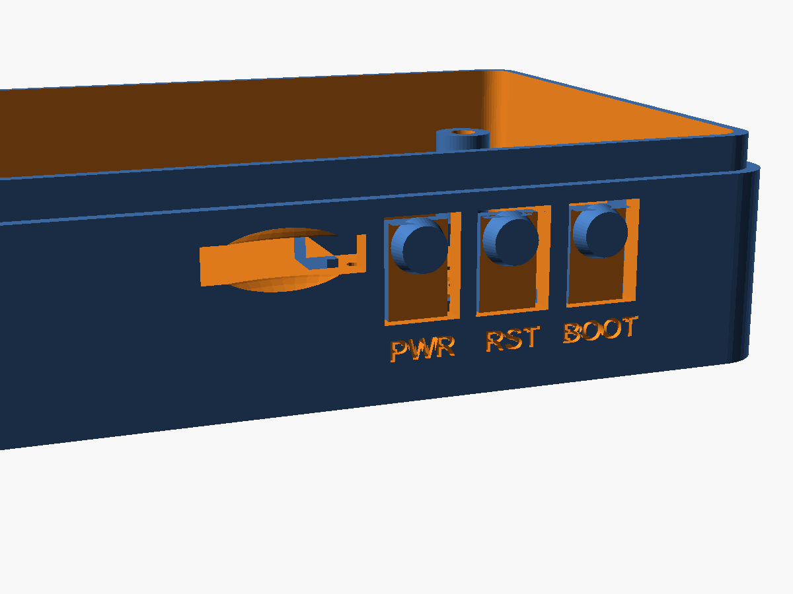

# Case: Waveshare ESP32-C5-Touch-LCD-2.8

Two-part printed case (tub + separate lid) for the [Waveshare build](../../docs/WAVESHARE-C5-28.md).
Outside size is 55.5 × 78 × 21 mm.

| File | What |
|---|---|
| `squachwatch_c5_28_case.scad` | Parametric source (OpenSCAD 2021+) |
| `print_plate.stl` | Both parts side by side as separate pieces, ready to slice |
| `back.stl` | Just the tub the board screws into. Print floor-down, no supports |
| `bezel.stl` | Just the lid (front frame over the glass border). Print face-down, no supports |



| Side buttons | Back |
|---|---|
|  |  |

## What it has

- The board screws in from the back with **4 × M2.5 × 14 mm pan-head screws**, into the board's M2.5 corner holes (41 × 60 mm pattern).
- **USB-C** cutout, with a recess so the plug's overmold can reach the port.
- **I2C** and **UART** SH1.0 header openings on the same edge (`io_ports`).
- **TF card** slot with a finger scoop on the right edge (`sd_slot`).
- **PWR / RST / BOOT** are flex tabs cut into the right wall. Each has a raised round pad outside, a nub inside that presses the side button, and its name engraved underneath (`buttons`, `button_labels`).
- **SQUACHWATCH** is engraved on the back under the speaker grille (`logo`; set it to `""` to leave it off).
- A pocket and grille for the **28 × 19 × 7 mm speaker**, which lies face-down on the floor under the top half of the board (`speaker`).
- Pin-holes for the PWR and charge LEDs (`led_holes`). Their positions are approximate.
- Under the bottom half of the board there's about 11 mm of free height, room for a flat LiPo of roughly 35 × 30 × 5 mm or smaller. It plugs into the MX1.25 BAT connector.

## Before printing: measure two numbers

Everything came from Waveshare's dimension drawing, but that drawing doesn't give
the board's thickness. Check these with calipers and set them at the top of the `.scad`:

- `lcd_stack`: from the PCB's front face to the glass front. The default is 4.6 mm. If it's off, the bezel either sits loose or won't seat.
- `back_clear`: from the floor to the PCB back. The default is 11.5 mm, which leaves room for the speaker plus the parts on the PCB back. Without the speaker or a battery you can drop it to about 6.

The port positions along the edges were scaled from that drawing (±0.5 mm). If a
cutout is off, change `usb_x`, `uart_x`, `i2c_x`, `sd_y` or `btn_y`.

## Build

```bash
openscad -o print_plate.stl squachwatch_c5_28_case.scad
openscad -D 'part="back"'  -o back.stl  squachwatch_c5_28_case.scad
openscad -D 'part="bezel"' -o bezel.stl squachwatch_c5_28_case.scad
```

The default part, `print`, renders the tub and the lid as two separate bodies, so OpenSCAD's F6 then Export STL gives you a ready plate. `part="assembly"` shows everything exploded with a mock board; it's for looking, not printing.

## Assembly

1. Put the speaker face-down in its pocket, then plug it into the Speaker header. If you use a battery, stick it to the floor below the speaker with foam tape and plug it into BAT.
2. Lower the board in, screen up, and screw it down from the back.
3. Press the bezel on. If it's loose, a few dots of glue on the step hold it. If it's too tight, raise `bezel_fit`.

Print in PLA or PETG with 0.2 mm layers and 3 walls. For the flex tabs, PETG springs back better.
